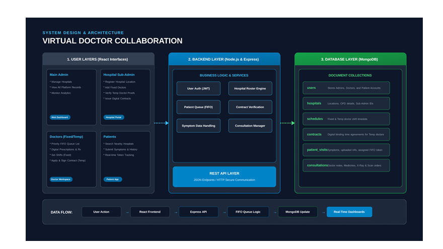
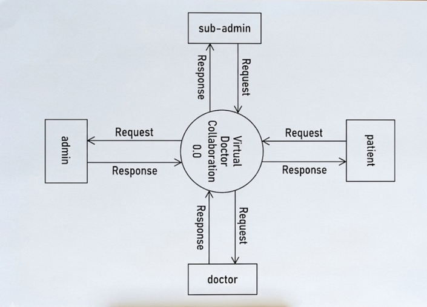
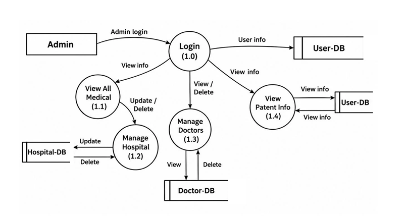
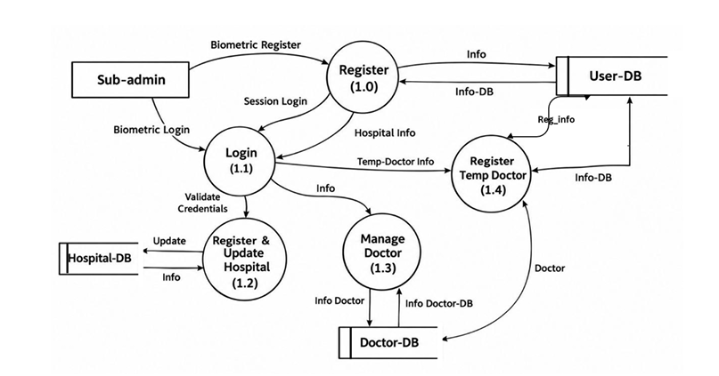
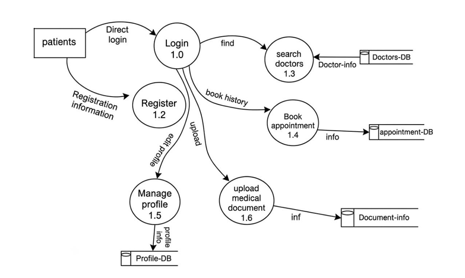
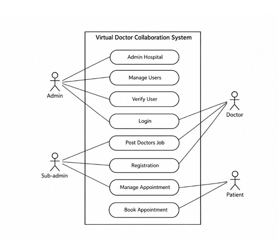

<div align="center">


---

```
███████╗      ██╗  ██╗███████╗ █████╗ ██╗  ████████╗██╗  ██╗    ██████╗ ██████╗ ██╗██████╗  ██████╗ ███████╗
██╔════╝      ██║  ██║██╔════╝██╔══██╗██║  ╚══██╔══╝██║  ██║    ██╔══██╗██╔══██╗██║██╔══██╗██╔════╝ ██╔════╝
█████╗  █████╗███████║█████╗  ███████║██║     ██║   ███████║    ██████╔╝██████╔╝██║██║  ██║██║  ███╗█████╗  
██╔══╝  ╚════╝██╔══██║██╔══╝  ██╔══██║██║     ██║   ██╔══██║    ██╔══██╗██╔══██╗██║██║  ██║██║   ██║██╔══╝  
███████╗      ██║  ██║███████╗██║  ██║███████╗██║   ██║  ██║    ██████╔╝██║  ██║██║██████╔╝╚██████╔╝███████╗
╚══════╝      ╚═╝  ╚═╝╚══════╝╚═╝  ╚═╝╚══════╝╚═╝   ╚═╝  ╚═╝    ╚═════╝ ╚═╝  ╚═╝╚═╝╚═════╝  ╚═════╝ ╚══════╝
```

# 🏥 Virtual Doctor Collaboration System

### *E-Health Bridge — Bridging Patients, Doctors & Hospitals in Real Time*

> **A full-stack MERN application** revolutionizing healthcare delivery through intelligent FIFO queue management, digital contracts, biometric sub-admin authentication, and real-time doctor-patient collaboration.

---

[](https://reactjs.org/)
[](https://nodejs.org/)
[](https://mongodb.com/)
[](https://vitejs.dev/)
[](https://tailwindcss.com/)
[](https://jwt.io/)

</div>

---

## 📋 Table of Contents

- [✨ Overview](#-overview)
- [🚀 Key Features](#-key-features)
- [🛠️ Technology Stack](#️-technology-stack)
- [🏗️ System Architecture](#️-system-architecture)
- [📊 Data Flow Diagrams](#-data-flow-diagrams)
- [📐 Use Case Diagram](#-use-case-diagram)
- [🗂️ Project Structure](#️-project-structure)
- [⚙️ Installation & Setup](#️-installation--setup)
- [🔐 Environment Variables](#-environment-variables)
- [👤 User Roles](#-user-roles)
- [📡 API Overview](#-api-overview)
- [📦 Database Models](#-database-models)
- [🤝 Contributing](#-contributing)

---

## ✨ Overview

The **Virtual Doctor Collaboration System (E-Health Bridge)** is a comprehensive healthcare management platform designed to tackle the critical problem of **doctor-side overcrowding** in hospitals. By leveraging modern web technologies and intelligent queue management, this system creates a seamless digital ecosystem connecting:

- 🏛️ **Admins** — Platform governance and hospital network oversight
- 🏥 **Hospital Sub-Admins** — Local hospital management with biometric authentication
- 👨‍⚕️ **Doctors** — Fixed & temporary roster with digital contracts and FIFO queues
- 🧑‍🤝‍🧑 **Patients** — Appointment booking, medical document upload, and real-time tracking

---

## 🚀 Key Features

<table>
<tr>
<td width="50%">

### 🔐 Authentication & Security
- JWT-based secure authentication
- Biometric sub-admin login
- Role-based access control (RBAC)
- Helmet.js & rate-limiting middleware
- Password hashing with bcryptjs

### 🏥 Hospital Management
- Hospital registration & verification
- OPD details & location management
- Digital contract issuance for temp doctors
- Hospital-specific doctor rosters

</td>
<td width="50%">

### 👨‍⚕️ Doctor Collaboration
- Fixed & temporary doctor profiles
- FIFO Priority Queue assignment
- Digital prescription generation
- X-Ray / Scan order management
- Shift scheduling (Fixed doctors)

### 👤 Patient Portal
- Self-registration & profile management
- Symptom submission & tracking
- Real-time appointment booking
- Medical document upload
- Consultation history access

</td>
</tr>
</table>

---

## 🛠️ Technology Stack

<div align="center">

### Frontend
| Technology | Version | Purpose |
|-----------|---------|---------|
| **React.js** | 18.2.0 | UI Framework |
| **Vite** | 5.2.0 | Build Tool & Dev Server |
| **React Router DOM** | 6.22.3 | Client-side Routing |
| **TailwindCSS** | 3.4.3 | Utility-first Styling |
| **Recharts** | 2.12.5 | Data Visualization & Charts |
| **Lucide React** | 0.368.0 | Modern Icon Library |
| **Three.js** | 0.186.1 | 3D Visuals / Animations |
| **Axios** | 1.6.8 | HTTP Client |

### Backend
| Technology | Version | Purpose |
|-----------|---------|---------|
| **Node.js** | LTS | Runtime Environment |
| **Express.js** | 4.19.2 | REST API Framework |
| **MongoDB** | Atlas / Local | NoSQL Database |
| **Mongoose** | 8.3.1 | ODM for MongoDB |
| **JSON Web Token** | 9.0.2 | Stateless Authentication |
| **bcryptjs** | 2.4.3 | Password Hashing |
| **Multer** | 1.4.5-lts | File / Document Uploads |
| **Helmet.js** | 7.1.0 | Security Headers |
| **Express Rate Limit** | 7.2.0 | API Rate Limiting |
| **Nodemon** | 3.1.0 | Dev Server Auto-reload |

</div>

---

## 🏗️ System Architecture

> Three-layer architecture: **React UI → Express API → MongoDB Atlas**



### Architecture Layers

```
┌─────────────────────────────────────────────────────────────────┐
│                    1. USER LAYER (React / Vite)                  │
│  ┌──────────────┐  ┌──────────────┐  ┌─────────┐  ┌─────────┐  │
│  │  Main Admin  │  │Hospital Sub- │  │ Doctor  │  │ Patient │  │
│  │  Dashboard   │  │  Admin Portal│  │  Panel  │  │   App   │  │
│  └──────────────┘  └──────────────┘  └─────────┘  └─────────┘  │
└────────────────────────────┬────────────────────────────────────┘
                             │ REST API (JSON / HTTP)
┌────────────────────────────▼────────────────────────────────────┐
│                2. BACKEND LAYER (Node.js / Express)              │
│  ┌──────────────────┐           ┌────────────────────────────┐  │
│  │  Business Logic  │           │       REST API Layer        │  │
│  │  User Auth (JWT) │           │  JSON Endpoints / HTTPS    │  │
│  │  Patient Queue   │           │  Authentication Middleware  │  │
│  │  Hospital Roster │           │  Rate Limiting / Helmet     │  │
│  │  Contract Mgmt   │           └────────────────────────────┘  │
│  └──────────────────┘                                            │
└────────────────────────────┬────────────────────────────────────┘
                             │ Mongoose ODM
┌────────────────────────────▼────────────────────────────────────┐
│                  3. DATABASE LAYER (MongoDB)                      │
│  users │ hospitals │ doctors │ appointments │ consultations       │
│  queues │ contracts │ patient_visits │ schedules │ audit_logs     │
└─────────────────────────────────────────────────────────────────┘
```

**Data Flow:** `User Action → React Frontend → Express API → FIFO Queue Logic → MongoDB Update → Real-Time Dashboard`

---

## 📊 Data Flow Diagrams

### 🔵 DFD Level 0 — Context Diagram

> High-level overview showing all external entities interacting with the system.



---

### 🟠 Admin — Level 1 DFD

> Detailed data flows for the **Main Admin** role: login, hospital management, doctor control, and patient record oversight.



| Process | Description |
|---------|-------------|
| **1.0 Login** | Admin authenticates → User-DB validates credentials |
| **1.1 View All Medical** | Admin views all platform records |
| **1.2 Manage Hospital** | Update / Delete hospital data → Hospital-DB |
| **1.3 Manage Doctors** | View, assign, remove doctors → Doctor-DB |
| **1.4 View Patient Info** | Read-only patient records → User-DB |

---

### 🟣 Sub-Admin — Level 1 DFD

> Hospital Sub-Admin processes: biometric login, hospital registration, doctor onboarding, and temp contract handling.



| Process | Description |
|---------|-------------|
| **1.0 Register** | Biometric-based sub-admin registration → User-DB |
| **1.1 Login** | Session/biometric login with credential validation |
| **1.2 Register & Update Hospital** | Manage hospital location & OPD info → Hospital-DB |
| **1.3 Manage Doctor** | View, add, and manage doctor records → Doctor-DB |
| **1.4 Register Temp Doctor** | Issue digital contracts for temporary doctors |

---

### 🟢 Doctor — Level 1 DFD

> Doctor portal data flows: login, queue management, patient consultation, prescription generation, and shift management.


---

### 🔴 Patient — Level 1 DFD

> Patient self-service flows: registration, direct login, appointment booking, doctor search, and medical document management.



| Process | Description |
|---------|-------------|
| **1.0 Login** | Direct login or registration gateway |
| **1.2 Register** | Patient self-registration with profile setup |
| **1.3 Search Doctors** | Find available doctors → Doctors-DB |
| **1.4 Book Appointment** | Book slots, view history → Appointment-DB |
| **1.5 Manage Profile** | Edit personal profile → Profile-DB |
| **1.6 Upload Medical Document** | Upload scan/reports → Document-info store |

---

## 📐 Use Case Diagram

> Actors and their interactions with the Virtual Doctor Collaboration System.



| Actor | Use Cases |
|-------|-----------|
| **Admin** | Admin Hospital, Manage Users, Verify User, Login |
| **Sub-Admin** | Login, Post Doctors Job, Registration, Manage Appointment |
| **Doctor** | Login, Verify User |
| **Patient** | Registration, Manage Appointment, Book Appointment |

---

## 🗂️ Project Structure

```
VirtualDoctorCollaborationSystem/
│
├── 📁 client/                    # React Frontend (Vite)
│   ├── 📁 src/
│   │   ├── 📁 components/        # Reusable UI Components
│   │   ├── 📁 pages/             # Route-based Page Components
│   │   │   ├── 📁 admin/         # Admin Dashboard Pages
│   │   │   ├── 📁 hospital/      # Sub-Admin Hospital Pages
│   │   │   ├── 📁 doctor/        # Doctor Workspace Pages
│   │   │   └── 📁 patient/       # Patient Portal Pages
│   │   ├── 📁 context/           # React Context (Global State)
│   │   ├── 📁 services/          # Axios API Service Calls
│   │   ├── App.jsx               # Root Router & Layout
│   │   ├── main.jsx              # React Entry Point
│   │   └── index.css             # Global Styles
│   ├── vite.config.js
│   └── tailwind.config.js
│
├── 📁 server/                    # Node.js / Express Backend
│   ├── 📁 src/
│   │   ├── 📁 config/            # DB Connection & Config
│   │   ├── 📁 controllers/       # Route Handler Logic
│   │   ├── 📁 middleware/        # Auth, Rate-limit, Security
│   │   ├── 📁 models/            # Mongoose Data Models
│   │   │   ├── User.js
│   │   │   ├── Hospital.js
│   │   │   ├── Doctor.js
│   │   │   ├── Patient.js
│   │   │   ├── Appointment.js
│   │   │   ├── Consultation.js
│   │   │   ├── Queue.js
│   │   │   ├── TemporaryContract.js
│   │   │   └── ...
│   │   ├── 📁 routes/            # Express API Routes
│   │   ├── 📁 services/          # Business Logic Services
│   │   ├── 📁 utils/             # Helper Utilities
│   │   ├── 📁 validators/        # Input Validation
│   │   ├── index.js              # Server Entry Point
│   │   └── seed.js               # Database Seeder
│   └── .env.example
│
├── 📁 docs/
│   └── 📁 diagrams/              # System Design Diagrams
│       ├── use_case_diagram.png
│       ├── system_architecture.png
│       ├── dfd_level0.png
│       ├── admin_level1_dfd.png
│       ├── subadmin_level1_dfd.png
│       ├── doctor_level1_dfd.png
│       └── patient_level1_dfd.png
│
├── 📁 uploads/                   # Uploaded Medical Documents
├── package.json                  # Root Scripts (concurrently)
└── README.md
```

---

## ⚙️ Installation & Setup

### Prerequisites

Make sure you have the following installed:

- **Node.js** ≥ 18.x — [Download](https://nodejs.org/)
- **MongoDB** (local) or a **MongoDB Atlas** cluster — [Get Atlas Free](https://www.mongodb.com/atlas)
- **Git** — [Download](https://git-scm.com/)

---

### 1️⃣ Clone the Repository

```bash
git clone https://github.com/YOUR_USERNAME/VirtualDoctorCollaborationSystem.git
cd VirtualDoctorCollaborationSystem
```

### 2️⃣ Install All Dependencies (One Command)

```bash
npm run install:all
```

> This installs dependencies for the root, `server/`, and `client/` simultaneously.

### 3️⃣ Configure Environment Variables

```bash
# Navigate to server directory
cd server

# Copy the example env file
cp .env.example .env

# Edit .env with your values
```

See [Environment Variables](#-environment-variables) section below.

### 4️⃣ Seed the Database (Optional)

```bash
npm run seed
```

> Populates the database with sample admins, hospitals, doctors, and patients for testing.

### 5️⃣ Start Development Servers

```bash
# From the root directory — starts both frontend and backend
npm run dev
```

| Service | URL |
|---------|-----|
| **React Client** | http://localhost:5173 |
| **Express API** | http://localhost:5000 |

---

## 🔐 Environment Variables

Create a `.env` file in the `server/` directory:

```env
# ─── Server ───────────────────────────────────
PORT=5000
NODE_ENV=development

# ─── MongoDB ──────────────────────────────────
MONGODB_URI=mongodb+srv://<username>:<password>@cluster.mongodb.net/eHealthBridge

# ─── JWT Authentication ───────────────────────
JWT_SECRET=your_super_secret_jwt_key_here
JWT_EXPIRES_IN=7d

# ─── CORS ─────────────────────────────────────
CLIENT_URL=http://localhost:5173
```

---

## 👤 User Roles

```
┌──────────────────────────────────────────────────────────────┐
│                       ROLE HIERARCHY                          │
│                                                               │
│   👑 ADMIN                                                    │
│   └── Full platform control                                   │
│   └── Manage hospitals, users, doctors, analytics            │
│                                                               │
│   🏥 SUB-ADMIN (Hospital Manager)                            │
│   └── Biometric login                                         │
│   └── Register & manage hospital                             │
│   └── Add fixed doctors, hire temp doctors                   │
│   └── Issue digital contracts                                │
│                                                               │
│   👨‍⚕️ DOCTOR (Fixed / Temporary)                             │
│   └── Priority FIFO queue access                             │
│   └── Digital prescriptions & consultations                  │
│   └── Set shifts (Fixed) / Apply for contract (Temp)         │
│                                                               │
│   🧑 PATIENT                                                  │
│   └── Search & book appointments                             │
│   └── Upload medical documents                               │
│   └── Track real-time queue token                            │
└──────────────────────────────────────────────────────────────┘
```

---

## 📡 API Overview

| Method | Endpoint | Access | Description |
|--------|----------|--------|-------------|
| `POST` | `/api/auth/login` | Public | User Login |
| `POST` | `/api/auth/register` | Public | Patient Registration |
| `GET` | `/api/admin/hospitals` | Admin | List All Hospitals |
| `POST` | `/api/hospital/register` | Sub-Admin | Register Hospital |
| `GET` | `/api/doctors` | Auth | List Doctors |
| `POST` | `/api/doctors/temp` | Sub-Admin | Register Temp Doctor |
| `POST` | `/api/appointments` | Patient | Book Appointment |
| `GET` | `/api/queue/:hospitalId` | Doctor | Get Patient Queue |
| `POST` | `/api/consultations` | Doctor | Create Consultation |
| `POST` | `/api/upload/document` | Patient | Upload Medical Doc |

---

## 📦 Database Models

```
MongoDB Collections
├── users              → Admins, Sub-admins, Doctors, Patients
├── hospitals          → Hospital locations, OPD, sub-admin IDs
├── doctors            → Fixed/Temp profiles, specialization, shifts
├── patients           → Patient info, history
├── appointments       → Booking records, status, tokens
├── consultations      → Doctor notes, prescriptions, scan orders
├── queues             → FIFO token queues per hospital/doctor
├── temporarycontracts → Digital binding agreements for temp doctors
├── schedules          → Fixed & temp doctor shift timetables
├── notifications      → In-app alerts for all roles
└── auditlogs          → System activity tracking
```

---

## 🤝 Contributing

Contributions are welcome! Please follow these steps:

1. **Fork** the repository
2. **Create** a feature branch: `git checkout -b feature/YourFeature`
3. **Commit** your changes: `git commit -m 'Add: YourFeature'`
4. **Push** to the branch: `git push origin feature/YourFeature`
5. **Open** a Pull Request

---

<div align="center">

---

**Built with ❤️ using the MERN Stack**

`MongoDB` • `Express.js` • `React.js` • `Node.js`

*E-Health Bridge — Virtual Doctor Collaboration System © 2026*

</div>
